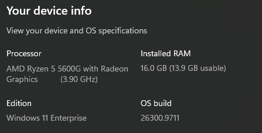
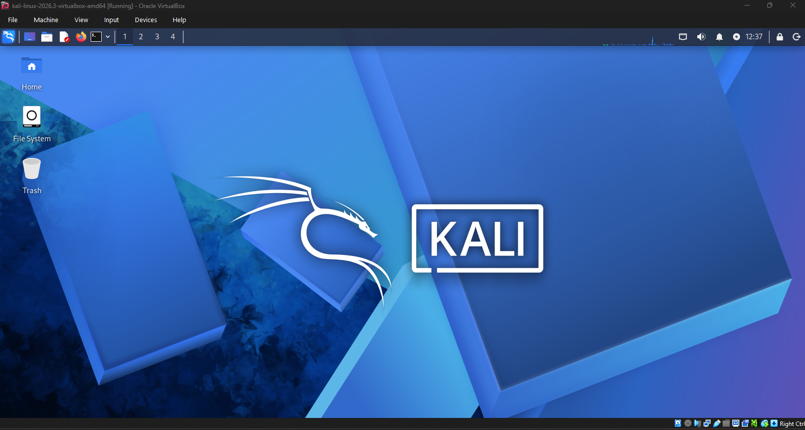
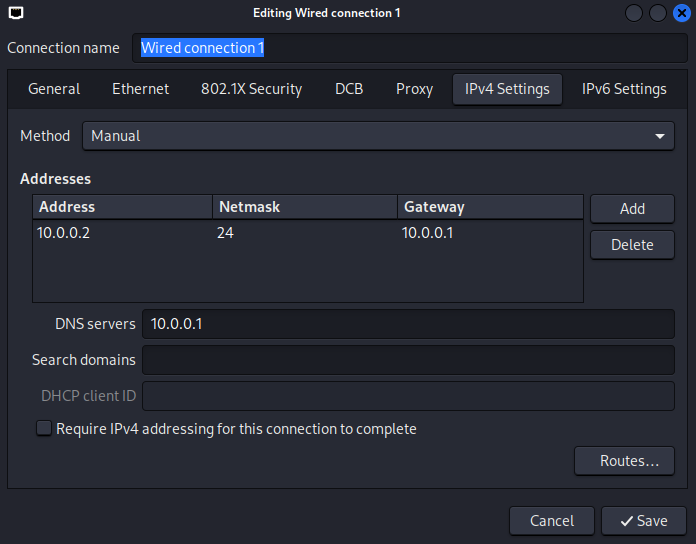
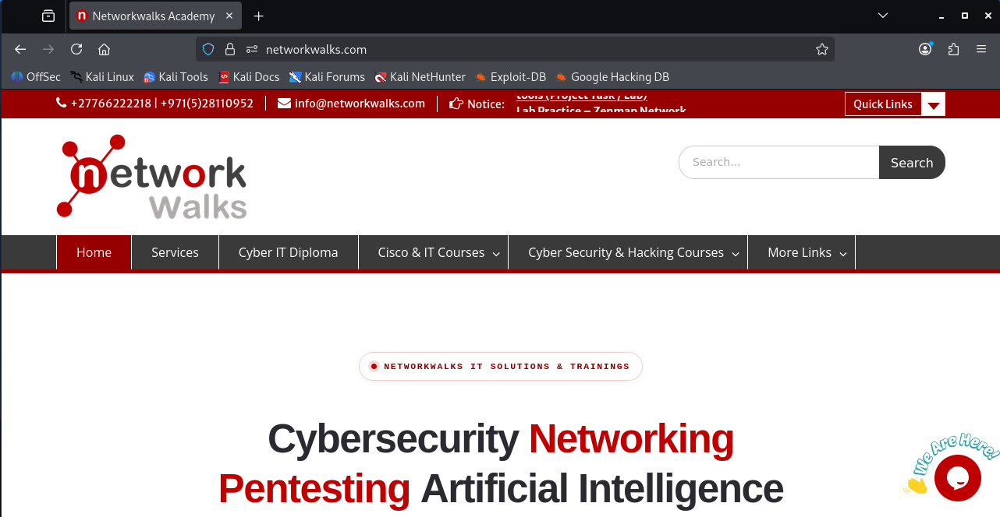

# Cybersecurity Lab Environment Setup

**Design and deployment of an isolated virtual laboratory for penetration testing and ethical hacking practice**

---

## Table of Contents

1. [Project Overview](#1-project-overview)
2. [Objectives](#2-objectives)
3. [Lab Specifications](#3-lab-specifications)
4. [Environment Documentation](#4-environment-documentation)
5. [Implementation Procedure](#5-implementation-procedure)
6. [Issues Encountered and Resolution](#6-issues-encountered-and-resolution)
7. [Key Learning Outcomes](#7-key-learning-outcomes)
8. [Security and Ethical Use](#8-security-and-ethical-use)
9. [Author and Project Information](#9-author-and-project-information)

---

## 1. Project Overview

This project documents the deployment of a virtual cybersecurity and penetration-testing laboratory using Oracle VM VirtualBox and Kali Linux.

The laboratory provides a controlled, isolated environment for repeatable security activities, including network scanning, reconnaissance, and vulnerability assessment. It operates on a private virtual network, which allows additional machines to be introduced later as authorized targets.

## 2. Objectives

- Install and configure Oracle VM VirtualBox as the virtualization platform.
- Import Kali Linux and designate it as the primary attacker machine.
- Provision a private NAT Network to keep the lab isolated.
- Apply a manual network configuration with a static IPv4 address on the Kali Linux VM.
- Verify network connectivity, including internet access and DNS resolution.
- Document the configuration and retain screenshots as evidence.
- Prepare the environment for subsequent cybersecurity project modules.

## 3. Lab Specifications

### 3.1 Host System

| Component | Specification |
| --- | --- |
| Operating System | Windows 11 Enterprise |
| Processor | AMD Ryzen 5 5600G with Radeon Graphics (3.90 GHz) |
| Installed RAM | 16 GB (13.9 GB usable) |
| Hypervisor | Oracle VM VirtualBox |

### 3.2 Virtual Machine

| Component | Specification |
| --- | --- |
| Guest Operating System | Kali Linux 2026.3 (64-bit) |
| Base Memory | 4096 MB |
| Processors | 2 |
| Storage | 80.09 GB (VDI, dynamically allocated) |
| Graphics Controller | VMSVGA (128 MB video memory) |

### 3.3 Network Configuration

| Parameter | Value |
| --- | --- |
| Network Type | NAT Network (`NatNetwork`) |
| Network Address | `10.0.0.0/24` |
| DHCP (VirtualBox) | Enabled |
| Kali IPv4 Address | `10.0.0.2/24` |
| Default Gateway | `10.0.0.1` |
| DNS Server | `10.0.0.1` |

## 4. Environment Documentation

The following screenshots document the completed configuration.

**Figure 1. Host system specifications**


**Figure 2. VirtualBox Manager showing the running Kali Linux VM**


**Figure 3. Kali Linux desktop running within VirtualBox**


**Figure 4. Static IPv4 configuration in NetworkManager (`10.0.0.2/24`, gateway `10.0.0.1`)**


**Figure 5. Internet connectivity verification via Firefox**


## 5. Implementation Procedure

### Step 1: Install Required Software

- Installed WinRar to extract the Kali Linux `.7z` archive.
- Installed Oracle VM VirtualBox as the hypervisor.

### Step 2: Create the NAT Network

A dedicated NAT Network was created to allow inter-VM communication while preserving outbound internet access.

| Setting | Value |
| --- | --- |
| Network Name | `NatNetwork` |
| IPv4 Prefix | `10.0.0.0/24` |
| DHCP | Enabled |

### Step 3: Import and Configure Kali Linux

- Imported the official prebuilt Kali Linux VirtualBox image.
- Attached the VM's network adapter to `NatNetwork`.
- Allocated 4096 MB of memory and 2 processors.
- Configured shared folders for host-to-guest file transfer.

### Step 4: Configure the Kali Linux Network

A static address was assigned through NetworkManager so the machine can be referenced consistently in later exercises.

| Setting | Value |
| --- | --- |
| Method | Manual |
| Address | `10.0.0.2` |
| Netmask | `24` (`255.255.255.0`) |
| Gateway | `10.0.0.1` |
| DNS | `10.0.0.1` |

### Step 5: Create a Baseline Snapshot

After connectivity was verified, a baseline snapshot (for example, `Clean Kali - Network Setup`) was captured. This provides a known-good state to restore if later testing destabilizes the system.

## 6. Issues Encountered and Resolution

### Loss of Internet Connectivity After Static IP Configuration

**Issue.** After the static IPv4 settings (`10.0.0.2`) were applied, the Kali VM was unable to reach the internet.

**Cause.** Per the instructor's troubleshooting guidance, this behavior is attributed to the duplicate address detection (DAD) timeout in newer releases of Kali Linux and VirtualBox.

**Resolution.** The DAD timeout was disabled for the connection and the connection was restarted:

```bash
sudo nmcli connection modify "Wired connection 1" ipv4.dad-timeout 0
sudo nmcli connection down "Wired connection 1"
sudo nmcli connection up "Wired connection 1"
```

**Result.** Internet access and DNS resolution were restored.

## 7. Key Learning Outcomes

1. **NAT versus NAT Network.** A NAT Network enables communication between VMs, which a multi-machine lab requires, while still permitting outbound internet access.
2. **Virtual machine networking.** Managing virtual adapters, routing, and manual IPv4 configuration in a Linux environment.
3. **Network troubleshooting.** Using `nmcli`, the NetworkManager command-line tool, to diagnose and resolve connection faults.
4. **Snapshot management.** Establishing a known-good baseline before conducting experimental security testing.

## 8. Security and Ethical Use

> **Important:** This laboratory is intended strictly for educational purposes. The tools and techniques practiced here must be used only on systems that are owned by the user or for which explicit, documented authorization has been obtained.

## 9. Author and Project Information

| | |
| --- | --- |
| **Author** | Jannatul Ferdous Sumu |
| **Role** | Cybersecurity Intern, Network Walks |
| **LinkedIn** | [linkedin.com/in/jannatul-ferdous-sumu](https://www.linkedin.com/in/jannatul-ferdous-sumu) |
| **Program** | Cybersecurity Internship at Network Walks |
| **Week** | 01 |
| **Project** | Cybersecurity and Pentesting Lab Setup |
